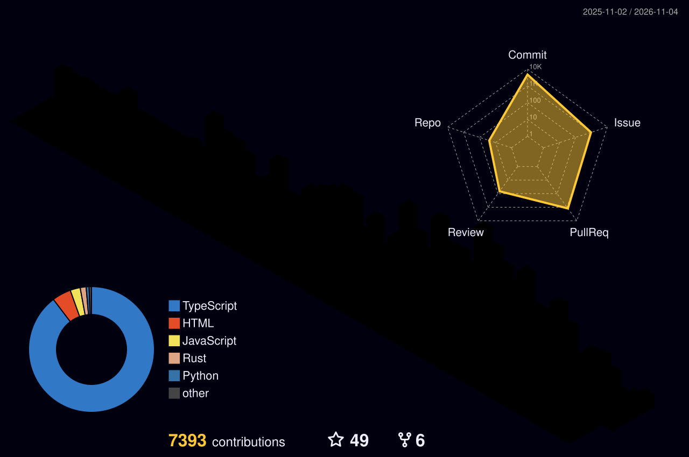

<!--
  GitHub Profile README for lifeodyssey
  Focus: Voice Agents · Backend Engineering · Cloud Infrastructure
-->

  

  
  

## 👋 About

I'm a software engineer on the **Voice Agent team at WATI**, based in Shenzhen. Previously, I spent over four years at **Thoughtworks**, working on backend systems and cloud infrastructure.

I enjoy working across services, infrastructure, and delivery. These days, I'm focused on voice agents and the engineering around them: harness design, context management, tool integration, and reliability. I share experiments and longer technical notes on [zhenjia.dev](https://zhenjia.dev/).

## 🔎 Current Focus

- **Voice agents** — real-time interactions, latency, and reliable service integration.
- **Agent infrastructure** — harnesses, context engineering, memory, and tool boundaries.
- **Developer workflows** — coding agents, evaluation, observability, and cost control.

## 🛠 Selected Projects

| Project | What it does |
|---|---|
| [Animichi](https://github.com/lifeodyssey/animichi) | An anime pilgrimage app with conversational search, maps, and route planning in Japanese, English, and Chinese. |
| [dsh-compressor](https://github.com/lifeodyssey/dsh-compressor) | A DeepSeek Harness plugin adapted from Headroom that compresses tool output, leaves cached prefixes unchanged, and lets agents retrieve the originals. |
| [Share HTML](https://github.com/lifeodyssey/share-html) | Share a single HTML file through a sandboxed preview, with unlisted public links and access-key-protected private links. |
| [Retypeset Odyssey](https://github.com/lifeodyssey/retypeset-odyssey) | An Astro theme extended from Retypeset, with multilingual publishing, npm distribution, and guidance for coding agents. Powers [my blog](https://zhenjia.dev/). |

## ✍️ Selected Writing

I write mainly in Chinese, with English and Japanese versions for selected posts.

- [从前后端到 Agent 开发的转行指南](https://zhenjia.dev/posts/frontend-backend-to-agent-career-guide) *(Chinese)*  
  A guide to agent engineering, organized around the problems a harness needs to solve.

- [The deepseek of DeepSeek Harness: Overengineering or built for self-evolution?](https://zhenjia.dev/en/posts/the-deepseek-of-deepseek-harness)  
  A close look at harness boundaries, plugin architecture, and the trade-offs behind agent self-evolution.

- [How to Optimize Coding Agent Costs](https://zhenjia.dev/en/posts/coding-agent-cost-optimization)  
  Research notes on prompt caching, context selection and compression, model tiering, and persistent memory.  
  [中文](https://zhenjia.dev/posts/coding-agent-cost-optimization) · [日本語](https://zhenjia.dev/ja/posts/coding-agent-cost-optimization)

## 🧰 Tools I Work With

Kotlin / Java, Python, and TypeScript; Spring Boot and PostgreSQL; AWS, Cloudflare, and Terraform. I care about clear service boundaries, useful tests, and systems that are straightforward to operate.

## 🌌 Beyond Code

Anime, live music, games, hiking, night-sky photography, and finding good food.

---

## 🌱 Contribution Flow

  <picture>
    <source
      media="(prefers-color-scheme: light)"
      srcset="./profile-3d-contrib/profile-season.svg"
    />
    
  </picture>

  
Contribution snake

  

    <picture>
      <source
        media="(prefers-color-scheme: dark)"
        srcset="https://raw.githubusercontent.com/lifeodyssey/lifeodyssey/output/github-snake-dark.svg"
      />
      <source
        media="(prefers-color-scheme: light)"
        srcset="https://raw.githubusercontent.com/lifeodyssey/lifeodyssey/output/github-snake.svg"
      />
      
    </picture>
  

